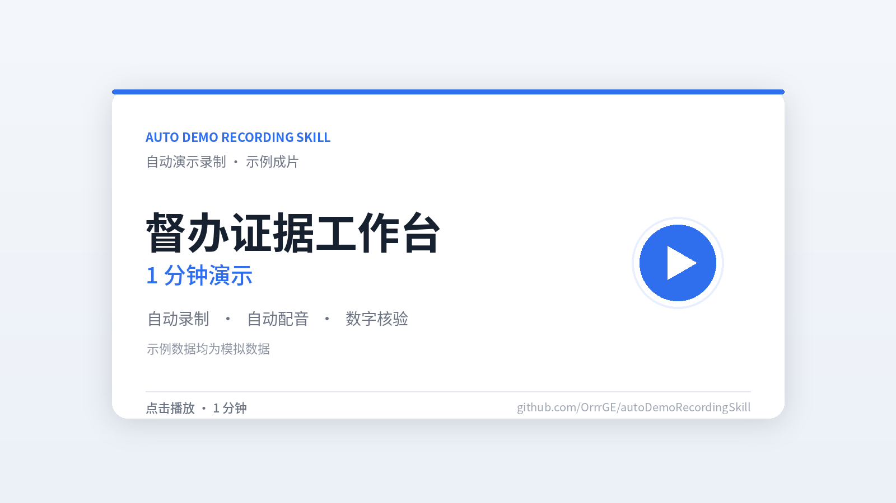

<div align="center">

# autoDemoRecordingSkill

**Record a polished, narrated demo video of a web app — from one Python story file.**
**用一个 Python 分镜文件，把 Web 应用做成带解说的演示视频。**

<a href="https://orrrge.github.io/autoDemoRecordingSkill/">
  
</a>

<sub>▶ 1 分钟演示 · 示例：督办证据工作台（任务、部门、材料均为模拟数据） · <a href="docs/media/demo-1min.mp4">直接播放 MP4</a></sub>

[交互式页面（中英文切换 + 在线视频）](https://orrrge.github.io/autoDemoRecordingSkill/) ·
[完整中文教程](README.zh-CN.md) ·
[Full English guide](README.en.md) ·
[MIT](LICENSE)

</div>


<details name="language">
<summary><b>English</b> · click to switch</summary>

### What it is

A Claude Code skill and standalone Python pipeline that turns a web app into a finished demo video. You write a
**story file** that says what to show and say; the scripts record the app, render the video, add the narration,
and check the result.

- **Record** — Playwright drives a headless Chromium through clicks, typing, scrolling and waits. The app runs as
  a throwaway instance with its own port and data.
- **Render** — 1920×1080 at 60 fps, with camera moves, outlines, spotlights, numbered steps, chapters and captions.
- **Narrate** — local Qwen3-TTS, one stable Mandarin voice, each line fitted to its caption.
- **Verify** — marked regions, label placement, caption fit, whisper transcription, speaker similarity, and
  packet hashes proving the picture was not re-encoded.

### Install and quick start

```bash
git clone https://github.com/OrrrGE/autoDemoRecordingSkill \
    ~/.claude/skills/autoDemoRecordingSkill
cd ~/.claude/skills/autoDemoRecordingSkill
python3 scripts/demo_env.py setup

PY=~/.cache/auto-demo-recording/venv/bin/python
$PY scripts/demo_record.py --story examples/selftest/story.py --work /tmp/demo-selftest
$PY scripts/demo_render.py --work /tmp/demo-selftest --check
$PY scripts/demo_render.py --work /tmp/demo-selftest --out /tmp/demo-selftest/selftest.mp4
$PY scripts/demo_voice.py --work /tmp/demo-selftest      # needs a GPU + speech models
```

Recording and rendering need no GPU. Full tutorial: **[README.en.md](README.en.md)**.

### Use it for your app

Copy [`story_template.py`](story_template.py), fill in `TITLE`, `CHAPTERS` and `launch()`, then direct the video
with `d.say`, `d.click`, `d.zoom`, `d.mark` and `d.until`. Full API: [`references/director.md`](references/director.md).
Narration options: [`references/narration.md`](references/narration.md). Installation:
[`references/environment.md`](references/environment.md).

> Record a throwaway instance with sample data. Frames are real screenshots; do not commit `work/`.

</details>

<details name="language" open>
<summary><b>中文</b> · 点击切换</summary>

### 这是什么

一个 Claude Code 技能，也是一组独立的 Python 脚本：把 Web 应用做成完整的演示视频。你只需要写一个
**story 文件**说明演示什么、说什么，录制、渲染、配音和核验都由脚本完成。

- **录制**：Playwright 驱动无头 Chromium，按 story 点击、输入、滚动、等待；应用以临时实例运行，独占端口和数据。
- **渲染**：1920×1080、60 fps，带镜头推近、框选、聚焦压暗、编号步骤、章节条和字幕。
- **配音**：本地 Qwen3-TTS，同一个稳定的普通话音色，逐句贴合字幕时长。
- **核验**：标注内容与颜色、标注文字位置、字幕是否放得下、Whisper 听写、CAM++ 声纹，以及证明画面未被重新编码的包哈希。

### 安装与快速开始

```bash
git clone https://github.com/OrrrGE/autoDemoRecordingSkill \
    ~/.claude/skills/autoDemoRecordingSkill
cd ~/.claude/skills/autoDemoRecordingSkill
python3 scripts/demo_env.py setup

PY=~/.cache/auto-demo-recording/venv/bin/python
$PY scripts/demo_record.py --story examples/selftest/story.py --work /tmp/demo-selftest
$PY scripts/demo_render.py --work /tmp/demo-selftest --check
$PY scripts/demo_render.py --work /tmp/demo-selftest --out /tmp/demo-selftest/selftest.mp4
$PY scripts/demo_voice.py --work /tmp/demo-selftest      # 需要显卡和语音模型
```

录制和渲染不需要显卡。完整教程见 **[README.zh-CN.md](README.zh-CN.md)**。

### 给自己的应用做视频

复制 [`story_template.py`](story_template.py)，填 `TITLE`、`CHAPTERS`、`launch()`，然后用
`d.say`、`d.click`、`d.zoom`、`d.mark`、`d.until` 写分镜。完整 API 见
[`references/director.md`](references/director.md)，配音设置见
[`references/narration.md`](references/narration.md)，安装见
[`references/environment.md`](references/environment.md)。


</details>

---

<div align="center">
<sub>MIT · <a href="https://github.com/OrrrGE/autoDemoRecordingSkill">GitHub</a> · <a href="https://orrrge.github.io/autoDemoRecordingSkill/">交互式页面</a></sub>
</div>
